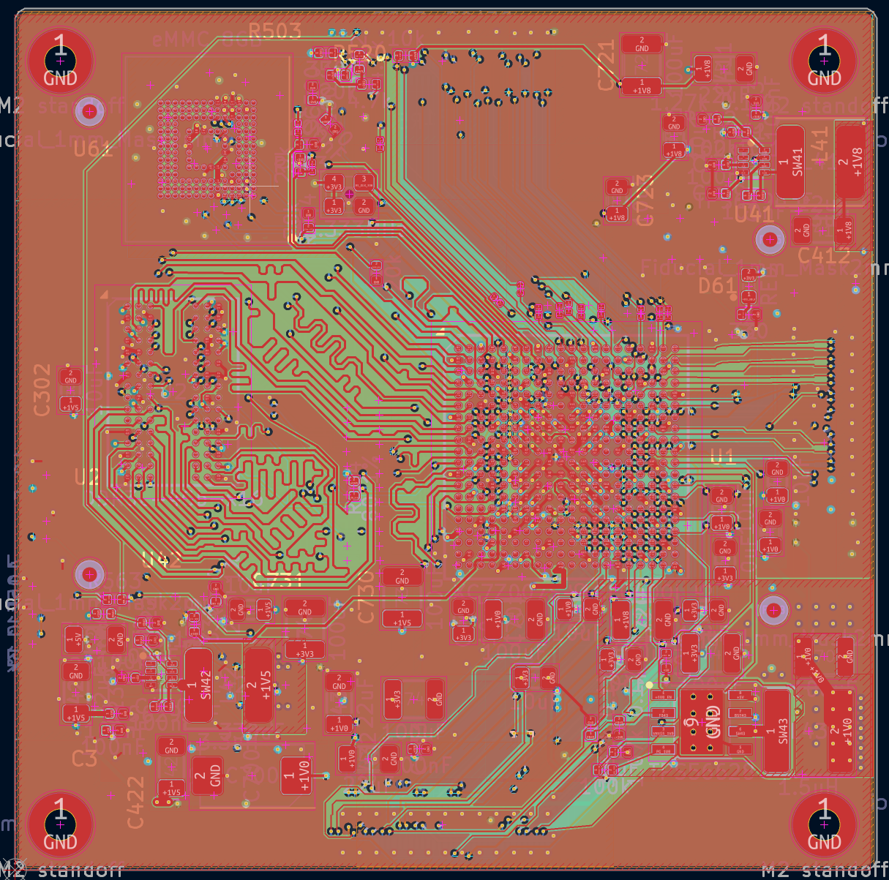
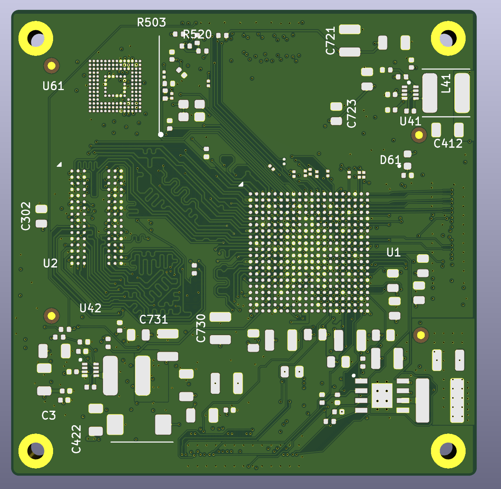
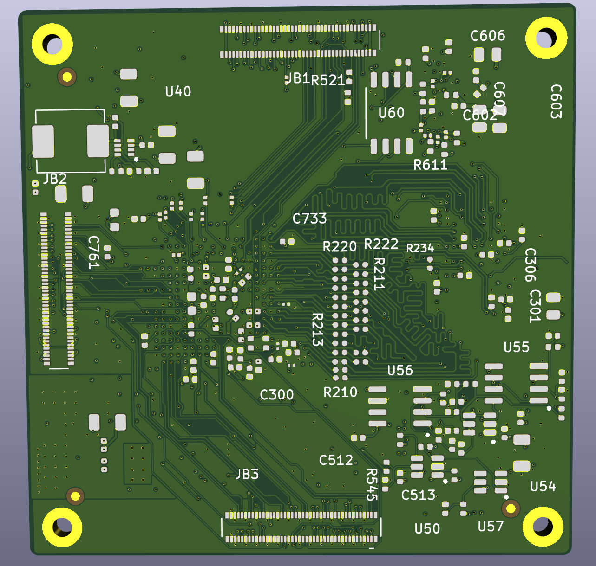
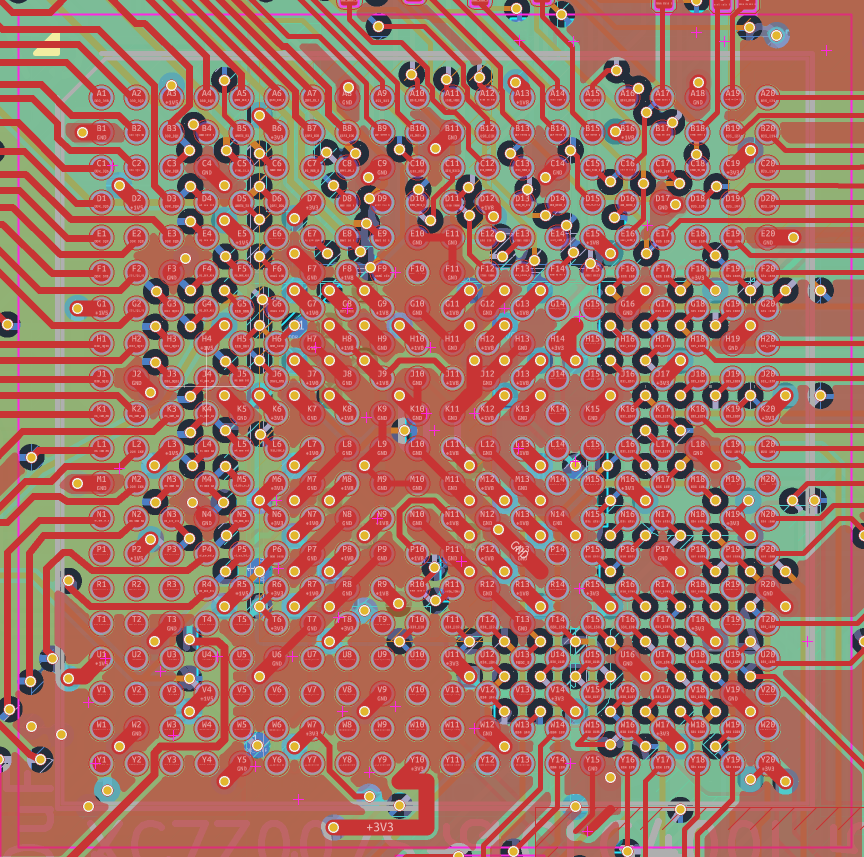
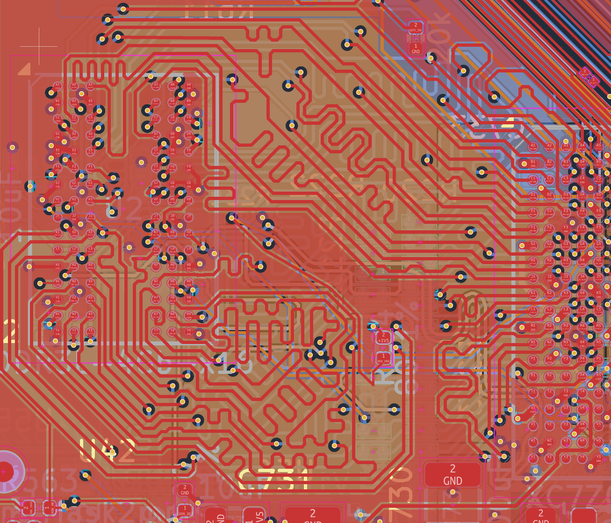

# Zynq-7000S SoM – 8-Layer PCB Design

## 1. Project Overview

This project involves the PCB design of a Zynq-7000S System-on-Module (SoM) based on the **Xilinx XC7Z007S-1CLG400I**.

The board is designed as an 8-layer PCB, integrating the Zynq-7000S device, DDR3 memory, configuration flash, power management circuits, and board-to-board interfaces.

**Project Status:** Work in Progress – approximately 80–90% complete  
**Hardware Revision:** V1

## 2. Hardware Platform

| Parameter | Description |
|---|---|
| Main Device | Xilinx Zynq-7000S XC7Z007S-1CLG400I |
| FPGA Package | CLG400 |
| PCB Layer Count | 8 Layers |
| External Memory | DDR3 |
| Configuration Memory | Flash |
| Design Tool | KiCad |

## 3. PCB Design Highlights

- Zynq-7000S component placement and BGA fanout.
- DDR3 memory interface routing.
- Power distribution and decoupling capacitor placement.
- Board-to-board connector integration.
- Multilayer PCB routing and signal integrity considerations.
- Component placement and routing optimization.

## 4. PCB Design Gallery

### 4.1 Overall PCB Layout

### 4.2 3D PCB Views

**Top View**

**Bottom View**

### 4.3 BGA Fanout

### 4.4 DDR3 Routing

## 5. Design Tools

- KiCad – Schematic capture and PCB layout.
- Datasheet-based component selection and design.
- PCB stackup and routing constraint considerations.

## 6. Project Status

The first hardware revision (V1) is approximately 80–90% complete.

Further design refinement and verification are still in progress.

## 7. Disclaimer

This project is presented as a PCB design portfolio. Completion of PCB layout does not imply completed hardware bring-up, electrical validation, or signal integrity testing.